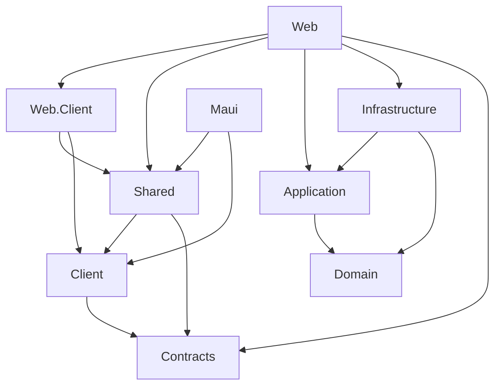

# Architecture

## Runtime shape

```text
Browser
  └─ Blazor WebAssembly + MSAL ─┐
                                ├─ Bearer access token ─> Tasks API
MAUI Blazor Hybrid + MSAL ──────┘                          │
                                                          v
                                              Tasks application slices
                                                          │
                                                          v
                                            PostgreSQL through EF Core

                         Microsoft Entra ID
                       (OIDC, separate clients)

Browser UI and MAUI UI both use BlazorMultihostStarter.Shared (RCL).
```

The Web host serves both the WebAssembly assets and `/api` endpoints in V1.
MAUI is a separate process and calls that same API. Neither UI host accesses
PostgreSQL or Infrastructure directly.

## Projects and responsibilities

| Project | Responsibility |
| --- | --- |
| `BlazorMultihostStarter.Domain` | Task invariants and domain entities; no EF Core or host dependencies. |
| `BlazorMultihostStarter.Application` | Tasks use cases, application results, and persistence ports, grouped by vertical slice. |
| `BlazorMultihostStarter.Contracts` | Stable HTTP request and response DTOs shared by API and clients. |
| `BlazorMultihostStarter.Infrastructure` | EF Core DbContext, PostgreSQL mapping, migrations, and repository adapters. |
| `BlazorMultihostStarter.Client` | Typed bearer-token HTTP API client and host-neutral authentication contract. |
| `BlazorMultihostStarter.Shared` | Razor Class Library: route, layout, components, and styles shared by both UI hosts. |
| `BlazorMultihostStarter.Web` | ASP.NET Core host, Entra JWT validation, API endpoints, and server composition root. |
| `BlazorMultihostStarter.Web.Client` | Browser-side MSAL/OIDC flow, token acquisition, and WebAssembly routes. |
| `BlazorMultihostStarter.Maui` | Native MAUI shell, MSAL public-client flow, platform broker setup, and API configuration. |

## Dependency direction



More precisely:

- `Domain` has no project references.
- `Application` references `Domain`.
- `Infrastructure` references `Application` and `Domain`.
- `Client` references only `Contracts`.
- `Shared` references `Client` and `Contracts`; it does not reference MAUI,
  Web host, API, or Infrastructure.
- Web and MAUI are composition roots. Only the Web host references server
  Application/Infrastructure projects.

The client and server may share DTOs, not EF entities. API contracts are not a
security boundary. The API validates the access token and scope, then derives
task ownership from validated Entra `tid` and `oid` claims. An owner ID in
client input is never trusted.

## Vertical slices and module boundary

`Tasks` is the first reference module. Application use cases live together by
feature and operation:

```text
Application/Modules/Tasks/
  Shared/
  ListTasks/
  GetTask/
  CreateTask/
  CompleteTask/

Shared/Modules/Tasks/
  TasksPage.razor
```

The Web API has one `Tasks` endpoint module, while Infrastructure owns the
EF-backed adapter for the module's application port. The solution uses direct
constructor injection rather than a mediator or reflection-based
auto-discovery. Add a framework only after multiple real slices demonstrate a
specific benefit.

`Tasks` is intentionally the only V1 business module. A future module should
have a clear capability boundary and explicit public contracts; do not create
empty layers or split projects merely to increase project count.

## Data flow

1. A shared Razor component calls `ITasksApiClient`.
2. The host-specific authentication session obtains a delegated access token
   through MSAL; the Web client and MAUI client keep separate public-client
   registrations and redirect configuration.
3. `TasksApiClient` attaches the access token to the HTTP request. It never
   sends a client-supplied owner ID.
4. The Tasks API validates the Entra signature, issuer, audience, allowed
   client ID, delegated scope, tenant, and user object ID.
5. The endpoint derives the owner key from `tid` + `oid` and invokes one
   application use case with that key.
6. Infrastructure filters every list/read/mutation by owner and persists
   through EF Core/PostgreSQL.
7. The API returns a public contract DTO; no EF entity crosses the boundary.

List requests are paginated: the API defaults to 25 items, enforces a maximum
page size of 100, and applies an in-memory fixed-window rate limit of 60
requests per minute per authenticated user. The limiter is per process; a
multi-instance production deployment needs an upstream or distributed limiter.

The Tasks list endpoint uses page-based results with a default page size of 25
and an enforced maximum of 100. API requests are rate-limited to 60 per minute
per authenticated tenant/user (or per remote IP before authentication).
The built-in limiter is in-memory and per process; multi-instance production
deployments need a distributed limiter or an upstream gateway policy.

Migrations are applied explicitly with `dotnet ef database update`; the Web
host does not mutate a production database automatically on startup.

## Operation/data modes

Blazor rendering mode and data authority are independent choices. The current
Web host uses Interactive WebAssembly, while MAUI renders locally in a
BlazorWebView. The Tasks feature is server-centric in both hosts: PostgreSQL
and the API remain authoritative and every request is authorized.

Client-local data is appropriate for non-sensitive preferences or disposable
drafts. A future hybrid/offline feature may cache server data or queue writes,
but must define sync, replay, conflict, and authorization behavior explicitly.
V1/V2 does not implement offline synchronization. See
[ADR-0002](./adr/0002-authentication-and-execution-modes.md).
