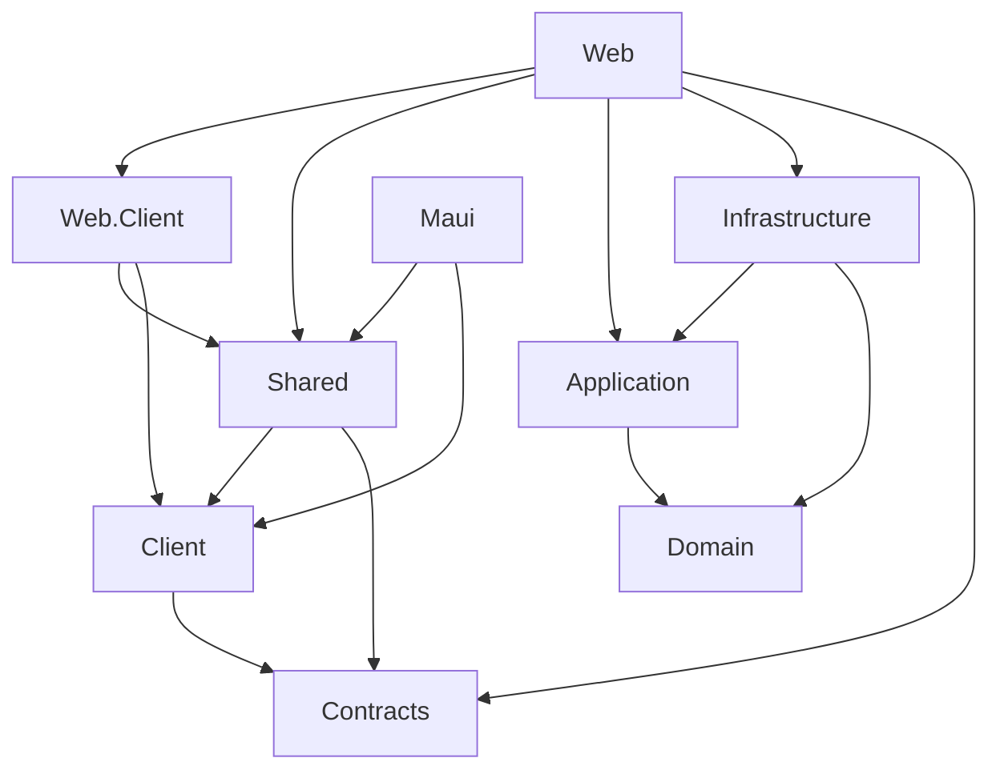

# Architecture

## Runtime shape

```text
Browser
  └─ Blazor WebAssembly client ─┐
                                ├─ HTTP API in the Web host
MAUI Blazor Hybrid ─────────────┘       └─ Tasks application slices
                                            └─ PostgreSQL through EF Core

Browser UI and MAUI UI both use BlazorMultihostStarter.Shared (RCL).
```

The Web host serves both the WebAssembly assets and `/api` endpoints in V1.
MAUI is a separate process and calls that same API. Neither UI host accesses
PostgreSQL or Infrastructure directly.

## Projects and responsibilities

| Project | Responsibility |
| --- | --- |
| `BlazorMultihostStarter.Domain` | Task invariants and domain entities; no EF Core or host dependencies. |
| `BlazorMultihostStarter.Application` | Tasks use cases, application results, and persistence ports, grouped by vertical slice. |
| `BlazorMultihostStarter.Contracts` | Stable HTTP request and response DTOs shared by API and clients. |
| `BlazorMultihostStarter.Infrastructure` | EF Core DbContext, PostgreSQL mapping, migrations, and repository adapters. |
| `BlazorMultihostStarter.Client` | Typed HTTP API client shared by WebAssembly and MAUI. |
| `BlazorMultihostStarter.Shared` | Razor Class Library: route, layout, components, and styles shared by both UI hosts. |
| `BlazorMultihostStarter.Web` | ASP.NET Core host, WebAssembly bootstrapping, API endpoints, and composition root. |
| `BlazorMultihostStarter.Web.Client` | Browser-side WebAssembly entry point and browser service registration. |
| `BlazorMultihostStarter.Maui` | Native MAUI shell, BlazorWebView, and device-specific API configuration. |

## Dependency direction



More precisely:

- `Domain` has no project references.
- `Application` references `Domain`.
- `Infrastructure` references `Application` and `Domain`.
- `Client` references only `Contracts`.
- `Shared` references `Client` and `Contracts`; it does not reference MAUI,
  Web host, API, or Infrastructure.
- Web and MAUI are composition roots. Only the Web host references server
  Application/Infrastructure projects.

The client and server may share DTOs, not EF entities. API contracts are not a
security boundary by themselves; future authentication and authorization must
be enforced by the API.

## Vertical slices and module boundary

`Tasks` is the first reference module. Application use cases live together by
feature and operation:

```text
Application/Modules/Tasks/
  Shared/
  ListTasks/
  GetTask/
  CreateTask/
  CompleteTask/

Shared/Modules/Tasks/
  TasksPage.razor
```

The Web API has one `Tasks` endpoint module, while Infrastructure owns the
EF-backed adapter for the module's application port. The solution uses direct
constructor injection rather than a mediator or reflection-based
auto-discovery. Add a framework only after multiple real slices demonstrate a
specific benefit.

`Tasks` is intentionally the only V1 business module. A future module should
have a clear capability boundary and explicit public contracts; do not create
empty layers or split projects merely to increase project count.

## Data flow

1. A shared Razor component calls `ITasksApiClient`.
2. The host supplies an `HttpClient`: same-origin for Web, configured API URL
   for MAUI.
3. The API endpoint validates the public request and invokes one application
   use case.
4. The use case applies domain rules and uses an application-owned repository
   port.
5. Infrastructure persists through EF Core and PostgreSQL.
6. The API returns a public contract DTO; no EF entity crosses the boundary.

Migrations are applied explicitly with `dotnet ef database update`; the Web
host does not mutate a production database automatically on startup.
