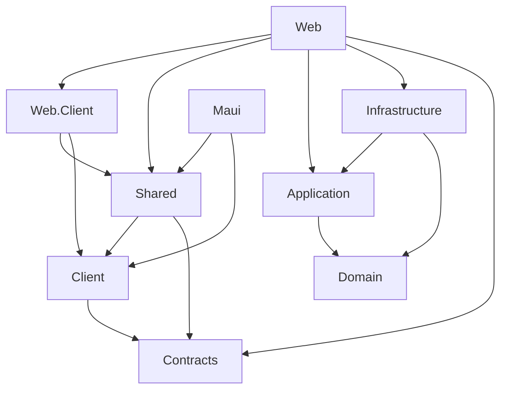

# Architecture

## Runtime shape

```text
Browser (WebAssembly + MSAL) ───────────────┐
                                            ├─ bearer token ─> Tasks API ─> PostgreSQL
MAUI Blazor Hybrid + MSAL ──────────────────┘

Browser (Interactive Server + OIDC cookie) ─────> Tasks Application ──────┘

Browser/WebView local-only page ──> IndexedDB (device-local)
Browser/WebView offline page ─────> IndexedDB queue ──> versioned sync API

All hosts render components from BlazorMultihostStarter.Shared (RCL).
```

The Web host provides both Interactive WebAssembly and Interactive Server.
`Web:Interactivity` selects the Web rendering mode; the default is
`WebAssembly`. MAUI always renders locally in a BlazorWebView. Rendering mode
and data authority are independent choices.

## Projects and responsibilities

| Project | Responsibility |
| --- | --- |
| `BlazorMultihostStarter.Domain` | Task invariants and versioned task entity; no host or EF dependencies. |
| `BlazorMultihostStarter.Application` | Task use cases and persistence port, grouped by vertical slice. |
| `BlazorMultihostStarter.Contracts` | HTTP request/response DTOs shared with API clients. |
| `BlazorMultihostStarter.Infrastructure` | EF Core, PostgreSQL mappings, migrations, and repository adapter. |
| `BlazorMultihostStarter.Client` | Host-neutral task client contracts, HTTP bearer client, and local/offline queue logic. |
| `BlazorMultihostStarter.Shared` | Shared Razor UI, IndexedDB adapter, mode navigation, and styles. |
| `BlazorMultihostStarter.Web` | ASP.NET Core composition root, JWT API, optional OIDC cookie host, endpoints, and persistence. |
| `BlazorMultihostStarter.Web.Client` | Browser MSAL flow and WebAssembly registration of the HTTP client. |
| `BlazorMultihostStarter.Maui` | Native shell, MSAL public client, platform redirects, and API configuration. |

## Dependency direction



- `Domain` has no project references.
- `Application` references `Domain`; `Infrastructure` implements application
  ports.
- `Client` references only API contracts; it does not depend on EF or hosts.
- `Shared` does not reference Web, MAUI, or Infrastructure. Its IndexedDB
  adapter uses the cross-host `IJSRuntime` supported by browser and WebView.
- WebAssembly and MAUI register an HTTP `ITasksClient`; Interactive Server
  registers a server adapter that invokes the same Application handlers.

Domain entities never cross the API boundary. The API does not accept an owner
ID from a client; it derives the owner from validated Entra `tid` and `oid`.

## Data modes

The routes are separate examples, not a global persistence switch:

| Route | Mode | Authority and storage |
| --- | --- | --- |
| `/` | Server-centric | API and PostgreSQL are authoritative. WebAssembly and MAUI use the protected API; Interactive Server invokes Application handlers under its authenticated user session. |
| `/tasks/local` | Client-local | IndexedDB in the current browser/WebView. No API, cross-device sharing, or sign-in. |
| `/tasks/offline` | Offline hybrid | IndexedDB stores local snapshots and pending edits; the authenticated API remains authoritative after manual sync. |

IndexedDB is per browser origin or installed app WebView. It can be cleared by
the user or platform and is not protected storage for credentials or sensitive
records. The local-only example intentionally does not synchronize.

Hybrid synchronization sends a task snapshot and its `BaseVersion`. New tasks
use client-generated IDs, making a repeated create request idempotent. Existing
tasks update only when the version still matches. The server increments a
concurrency-token version and returns `409 Conflict` with the current server
snapshot when another edit won. The UI requires an explicit choice to keep the
server version or rebase and retry the local snapshot; there is no silent
last-write-wins behavior. Sync is manual and has no background worker.

## Web interactivity modes

- **Interactive WebAssembly:** the browser is a public MSAL client and calls
  the same-origin bearer-token API. This is the default.
- **Interactive Server:** the browser uses an OIDC cookie session. The
  server-side task client calls Application handlers directly; it does not
  forward a browser token to its own API. This mode requires a confidential
  Entra Web client and a secret stored outside source control.
- **MAUI Blazor Hybrid:** UI events run in the native app's WebView; MAUI uses
  its own MSAL public-client registration and calls the protected API.

Change `Web:Interactivity` to `Server` or `WebAssembly` in Web configuration.
The authentication mechanisms differ by host, while the RCL and business
invariants are shared. A mode change does not change the authority of the data
mode selected by a feature.

## Vertical slices and modules

`Tasks` is the reference VSA module:

```text
Application/Modules/Tasks/
  CreateTask/
  GetTask/
  ListTasks/
  CompleteTask/
  SyncTask/
```

Each new capability should add only the UI, application use case, persistence
port/adapter, API contract/endpoint (if required), and tests it needs. The
solution uses direct constructor injection rather than a mediator or
reflection-based discovery. Add a framework only after multiple real slices
demonstrate its value.

## API and synchronization safeguards

- All Tasks API routes require a valid Entra access token, issuer, audience,
  approved client ID, delegated scope, tenant, and object ID.
- Every list/read/mutation is scoped by the authenticated owner.
- Lists default to 25 items and reject page sizes above 100.
- The API rate limit is 60 requests per minute per authenticated owner in each
  process. Multi-instance deployments need a distributed limiter or gateway
  policy.
- EF's task version is an optimistic concurrency token. Stale local snapshots
  produce a conflict response; an API request never supplies an owner ID.
- Migrations are applied explicitly with `dotnet ef database update`; the Web
  host does not mutate a production database automatically.

## Provider and production boundaries

The reference implementation is intentionally specific to Microsoft Entra ID,
MSAL, PostgreSQL, and EF Core. The template parameterizes application names,
bundle ID, and public Entra IDs; it does not ship alternate identity or
database providers. Replacing a provider requires adapting and validating the
host-specific auth/storage layer.

This is a learning/reference starter, not production-ready software. Real
Entra sign-in on every claimed platform, deployment-specific HTTPS redirects,
production operations, and a multi-instance rate-limit strategy must be
verified separately. See the ADRs for explicit evidence boundaries.
